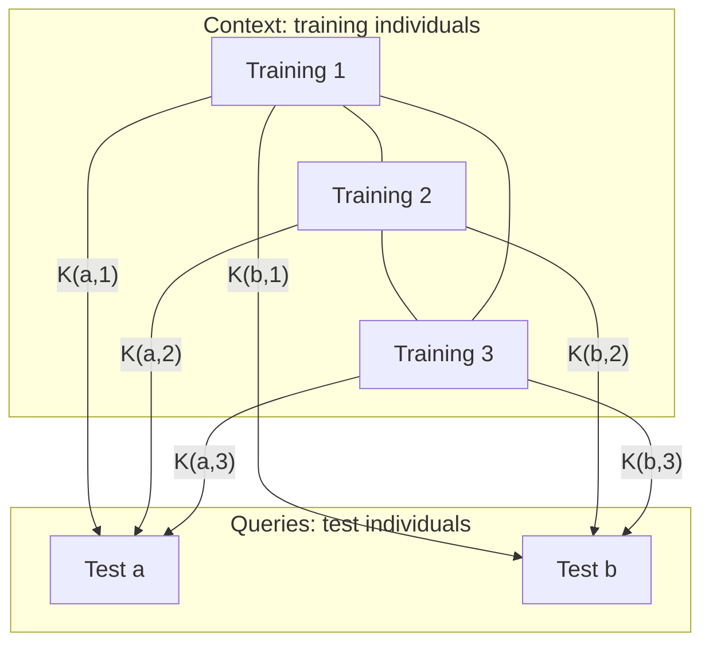
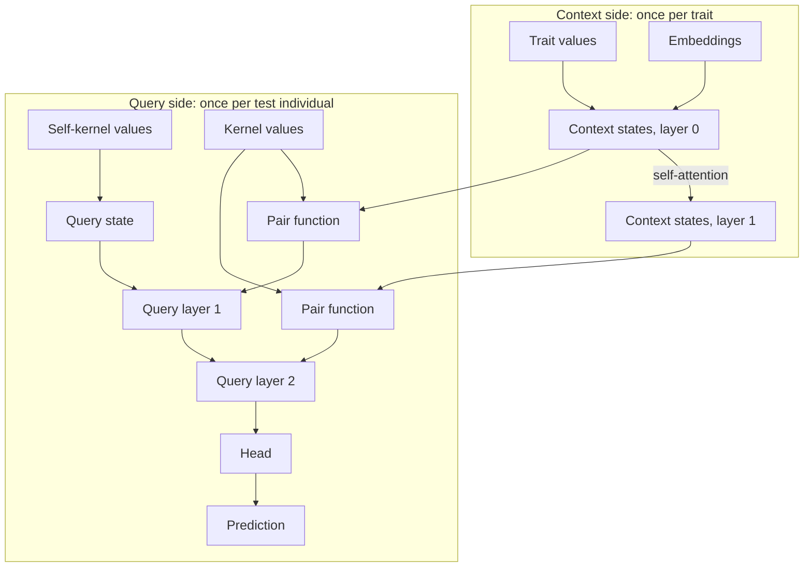

# A simulation-trained PFN as a generalization of BLUP

*17 November 2026*

## Summary

BLUP is the Bayes-optimal predictor under one fixed Gaussian kernel. A prior-data fitted network (PFN, the model class behind TabPFN) is trained to be Bayes-optimal under any prior that can be sampled, Gaussian or not. This note describes a PFN for one fixed training cohort that keeps BLUP’s interface and drops its Gaussian assumptions.

BLUP combines the test individual’s covariance values with one precomputed number per training individual, by a dot product. The network keeps both ingredients and learns everything else.

The network is a PFN-style transformer. The training individuals with their trait values are the context, processed with self-attention. Each test individual is a query that reads the context through cross-attention, and what it reads from each training individual is that individual’s state paired with their kernel values. At inference the context is encoded once per trait and reused for every test individual.

The two ingredients are used as follows:

- **Cheap simulation:** any prior on genetic effects that can be simulated supplies an unlimited stream of training phenotypes. What the network learns about the cohort and the prior accumulates in its parameters.
- **Cheap pairwise kernel values:** they are the only description of a test individual the network receives.

No part of the network is derived from Gaussian algebra. The Gaussian case is kept only as a check: the network must be able to reproduce BLUP and kernel-averaged BLUP when the prior is Gaussian.

## Terms

Each symbol has one name throughout, and the word “weights” is not used.

| Symbol | Name | Meaning |
| --- | --- | --- |
| $\theta$ | Prior hyperparameters | Whatever the prior draws before the genetic values. In the Gaussian check these are the variance components |
| $K_1, \dots, K_M$ | Kernels | Fixed similarity functions between individuals. They need not be the covariance of the prior |
| $\kappa_{*i}$ | Test covariance values | The $M$ kernel values between the test individual and training individual $i$ |
| $\kappa_{**}$ | Self-kernel values | The $M$ kernel values of the test individual with itself |
| $\phi$ | Network parameters | All trained numbers in the network |
| $e_i$ | Individual embeddings | One learned vector per training individual, part of $\phi$ |
| $h_i^{(\ell)}$ | Context states | The state of training individual $i$ after context layer $\ell$, computed from the trait values of the whole cohort |
| $q^{(\ell)}$ | Query state | The state of a test individual after query layer $\ell$ |
| $p_{*i}^{(\ell)}$ | Pair representations | What a query reads from training individual $i$: the context state joined with the test covariance values |
| $\alpha^{(m)}(y)$ | Coefficients | The $n$-vectors of BLUP and kernel-averaged BLUP. Used only in the Gaussian check |
| $B$ | Probe individuals | The query individuals used in training, whose simulated genetic values are predicted |

## Background

The motivating result is empirical: an untuned TabPFN-3.5, given marker genotypes directly, is competitive with standard genomic prediction methods. The preprint is [Flagel, bioRxiv 2026.11.03.764067](https://www.biorxiv.org/content/10.64898/2026.11.03.764067v1).

- The benchmark covers 18 traits in six plant species.
- On matched splits against the best of GBLUP, RKHS and elastic net, TabPFN-3.5 was ahead on 12 of 18 traits.
- It was significantly behind on one trait, spruce wood density.

That result uses TabPFN’s generic prior, which is not a kernel family. This note asks a different question: what a PFN would compute if it were trained on genetic priors simulated on one cohort.

## Setup and BLUP

BLUP is the minimizer of a prediction risk taken over draws from a Gaussian prior. This is the property that links it to a PFN, and it is the baseline the rest of the note generalizes.

There are $n$ training individuals with genotypes $x_i$ and phenotypes $y$. The model is a genetic value $f$ plus noise:

$$
y = f + \varepsilon, \qquad f \sim \mathcal{N}(0, K), \qquad \varepsilon \sim \mathcal{N}(0, \sigma^2 I)
$$

For a test individual with genotype $x_*$, the covariance vector to the training individuals is:

$$
k_* = \big( k(x_*, x_i) \big)_{i=1}^{n} \in \mathbb{R}^n
$$

The BLUP of the test genetic value is a precomputed coefficient vector times that covariance vector:

$$
\hat{y}_* = k_*^\top \alpha, \qquad \alpha = (K + \sigma^2 I)^{-1} y
$$

The same predictor solves a least-squares problem over prior draws of the pair $(f_*, y)$:

$$
w^\star = \arg\min_{w} \; \mathbb{E}_{(f_*,\, y) \sim \text{prior}} \big[ (f_* - w^\top y)^2 \big] = (K + \sigma^2 I)^{-1} k_*
$$

Because $(f_*, y)$ is jointly Gaussian, this linear predictor equals the conditional mean $\mathbb{E}[f_* \mid y]$. It is therefore optimal among all functions of $y$, not only linear ones.

## The PFN objective

A PFN minimizes the same kind of risk as BLUP, over a flexible function class and under any prior that can be sampled. The network $q_\phi$ is trained on datasets $D$ drawn from a prior $\pi$ over generative parameters $\theta$:

$$
\mathcal{L}(\phi) = \mathbb{E}_{\theta \sim \pi} \; \mathbb{E}_{(D,\, x_*,\, y_*) \sim p(\cdot \mid \theta)} \big[ -\log q_\phi(y_* \mid x_*, D) \big]
$$

The minimizer of this loss is the posterior predictive distribution:

$$
q^\star(y_* \mid x_*, D) = \int p(y_* \mid x_*, D, \theta) \, p(\theta \mid D) \, d\theta
$$

Training needs only samples of $(\theta, D)$. It never evaluates a density, a kernel matrix or an inverse.

With a single fixed Gaussian kernel, $q^\star$ is Gaussian with the BLUP as its mean and the prediction error variance as its variance. BLUP is the special case of a PFN whose prior has one kernel. Nothing in the objective itself requires the prior to be Gaussian.

## Beyond the Gaussian case

Only two things carry over from BLUP to a general prior: the test individual is described by its kernel values to the cohort, and the predictor is the posterior expectation given what the network is shown. Everything else in the BLUP formula is specific to Gaussian priors.

### Priors and kernels

A prior is any sampler that draws hyperparameters $\theta$ and then genetic values jointly for the cohort and for extra individuals. Examples:

- Gaussian genetic values with one kernel or a random combination of kernels.
- Marker effects with sparse or heavy-tailed distributions, as in the Bayesian alphabet.
- Epistatic or otherwise nonlinear maps from genotype to genetic value.
- Mixtures of the above.

The kernels $K_1, \dots, K_M$ are fixed similarity functions between individuals. Under a Gaussian prior its covariance is built from them. Under other priors they only describe how a test individual relates to the cohort. For training individual $i$, the test individual contributes $M$ numbers, and it contributes $M$ more for itself:

$$
\kappa_{*i} = \big( K_1(x_*, x_i), \dots, K_M(x_*, x_i) \big), \qquad \kappa_{**} = \big( K_1(x_*, x_*), \dots, K_M(x_*, x_*) \big)
$$

The full description of the test individual is $\kappa_* = (\kappa_{*1}, \dots, \kappa_{*n}, \kappa_{**})$. The self-kernel values matter for the spread of the prediction, as the prediction error variance of BLUP shows.

### The target

The network is trained to output the predictive distribution of the test genetic value given the cohort phenotypes and the test covariance values. By the PFN objective, its optimum is:

$$
q^\star(f_* \mid y, \kappa_*) = p(f_* \mid y, \kappa_*)
$$

This holds for any prior that can be simulated. It is the best possible prediction from $y$ and $\kappa_*$, and its mean is the best point prediction under squared error.

It equals the full Bayes prediction $p(f_* \mid y, x_*)$ only when the prior uses the test genotype through $\kappa_*$ alone. That is true for Gaussian priors on these kernels. For other priors some information about the test individual is lost at this interface, and adding kernels reduces the loss.

### What is specific to the Gaussian case

- **Linearity in $y$:** holds only for a single Gaussian kernel with known variance components.
- **Linearity in the test covariance values:** holds for Gaussian kernel families. Under a marker-effect prior the predictor is linear in the test genotype, but generally not in a small fixed set of covariance vectors.
- **Short exact summaries of $y$:** projections of $y$ and its squared norm suffice when genetic values are linear in marker effects and the noise is Gaussian, whatever the prior on the effects. Nonlinear maps from genotype to genetic value have no such guarantee.
- **Coefficients as the stored object:** one number per individual and kernel is enough only when the predictor is a dot product.

None of these is built into the network below.

## Fixing the training cohort

The network is trained for one cohort, so what it needs to know about the cohort can live in its parameters and be learned from the stream of simulated phenotypes. The training individuals and their kernels never change. Each training step resamples only the prior hyperparameters and the realization:

$$
\theta \sim \pi, \qquad (f, f_B) \sim p(\cdot \mid \theta), \qquad y = f + \varepsilon
$$

Here $f$ holds the genetic values of the cohort and $f_B$ those of the probe individuals. After $N$ draws the network has seen $N$ samples from the prior on this cohort, so what it knows grows with $N$ without a ceiling set in advance.

This is the difference from giving the network a fixed set of $S$ kernel samples per individual as input. That design caps what the network can know about the cohort at $S$ samples, and more training cannot lift the cap.

Under non-Gaussian priors the cohort’s genotypes matter in ways the kernels do not capture. The learned embeddings can absorb that information from the simulations, because they are free parameters tied to individuals.

What is and is not amortized:

- **Amortized:** traits (realizations of $y$), prior hyperparameters, and test individuals.
- **Not amortized:** the cohort. A different set of training individuals needs its own trained network.

## The network

The network is a PFN: a transformer in which the training individuals form the context and each test individual is a query that reads the context through cross-attention. The context holds only trait values. A test individual enters only through its kernel values.

### Context tokens

There is one context token per training individual. Its input is the individual’s trait value plus a learned embedding that identifies the individual:

$$
h_i^{(0)} = \mathrm{emb}_\phi(y_i) + e_i
$$

The embedding $e_i$ plays the role that feature columns play in a tabular PFN. Without it the context would be an unordered bag of trait values. It can be a free parameter because the cohort is fixed.

The context passes through $L$ transformer layers with self-attention among the context tokens:

$$
\big( h_1^{(\ell)}, \dots, h_n^{(\ell)} \big) = \mathrm{CtxLayer}_\phi^{(\ell)}\big( h_1^{(\ell-1)}, \dots, h_n^{(\ell-1)} \big), \qquad \ell = 1, \dots, L
$$

Context tokens never attend to queries, so the context states depend on $y$ alone. Relationships among training individuals are not given as input. Self-attention learns them through the embeddings, from the simulated traits.

### Query tokens

There is one query per test individual. Its only features of its own are the self-kernel values, which set its initial state:

$$
q^{(0)} = \mathrm{emb}_\phi(\kappa_{**})
$$

The self-kernel values $\kappa_{**}$ are only $M$ numbers, the kernel values of the test individual with itself. The $n \times M$ kernel values to the cohort, $\kappa_{*1}, \dots, \kappa_{*n}$, are not part of the initial state. They enter at every query layer, as follows.

What the query reads from training individual $i$ is a pair: that individual’s context state, which encodes the trait values, and the kernel values between the test individual and $i$. A learned function joins the pair:

$$
p_{*i}^{(\ell)} = g_\phi^{(\ell)}\big( h_i^{(\ell)},\; \kappa_{*i} \big)
$$

Each query layer is cross-attention from the query state to these $n$ pair representations, followed by the usual feed-forward update:

$$
q^{(\ell)} = \mathrm{QryLayer}_\phi^{(\ell)}\big( q^{(\ell-1)} \,;\; p_{*1}^{(\ell-1)}, \dots, p_{*n}^{(\ell-1)} \big), \qquad \ell = 1, \dots, L
$$

Inside the layer, the attention scores compare the query state with each pair representation, and the query receives the attended combination:

$$
a_i = \frac{\exp\big\langle W_Q\, q,\; W_K\, p_{*i} \big\rangle}{\sum_{k=1}^{n} \exp\big\langle W_Q\, q,\; W_K\, p_{*k} \big\rangle}, \qquad \mathrm{read} = \sum_{i=1}^{n} a_i\, W_V\, p_{*i}
$$

Queries do not attend to each other. The final query state goes to an output head that gives the predictive distribution:

$$
q_\phi(f_* \mid y, \kappa_*) = \mathrm{head}_\phi\big( q^{(L)} \big)
$$

The head outputs a full distribution, because under non-Gaussian priors the predictive distribution has no fixed shape. The [default bar head](#default-output-a-pfns-bar-distribution) supplies this density and its mean for point prediction.

### Attention pattern and information flow

Two rules fix the attention pattern: context tokens attend only to context tokens, and each query attends only to the context.

| Attending token | Reads context tokens | Reads query tokens |
| --- | --- | --- |
| Context token | Yes, all of them, by self-attention | No |
| Query token | Yes, all of them, each joined with its kernel values | No |

The first diagram shows the pattern for three training individuals and two test individuals. Each training token holds a trait value and a learned embedding, and each test token starts from its self-kernel values. Plain lines are mutual attention among context tokens. Arrows show information passing from a context token to a query. The label K(a,1) stands for the $M$ kernel values between test individual a and training individual 1.

Nothing flows from a query back to the context or to another query. The context states are therefore the same for every test individual, and test individuals can be predicted in any order or in parallel.

The second diagram shows how the inputs flow through the layers, drawn for two query layers. Query layer $\ell$ reads the context states of layer $\ell - 1$, each joined with the kernel values by the pair function. Each pair function outputs $n$ pair representations, one per training individual.

The trait values and the learned embeddings enter only on the context side. The kernel values enter only on the query side, at every query layer. The two sides meet in the pair function.

### Why the kernel values enter through the pair

The kernel values are joined with the context state before attention, not added to the attention scores alone. Softmax attention returns a weighted average of what it reads, so kernel values that only shift the scores could not reproduce a sum of products such as BLUP’s. With the pair function, the product of a kernel value and a per-individual quantity can be formed inside what is read.

### Cost and caching

- **Per trait:** the context is run once. Each context layer computes $n^2$ attention scores, so the cost is $O(L\, n^2)$. The context states of all layers are stored.
- **Per test individual:** $n \times M$ kernel values are computed, and each query layer evaluates the pair function $n$ times and attends over $n$ items. The cost is $O(L\, n)$, with nothing recomputed on the context side.
- **Per training step:** one context pass for the simulated trait, plus one query pass per probe individual.

The attention scores are computed on the fly and need not be stored. A cohort too large for $n^2$ computation per layer would need an approximation, such as context tokens that interact through a smaller set of latent tokens.

### Default output: a PFNs bar distribution

Express the simulated genetic value on the standardized phenotype scale,
$\tilde f_*=(f_*-\bar y)/\mathrm{sd}(y)$. Fix the reference edges before
training, for example from quantiles of simulated targets on this scale.

The [default Navi head](model_draft.md#default-output-head-and-training-loss)
maps the final query state to one logit per bar. Softmax gives the bar
masses $\pi_j$, and the conditional density $f_j$ within a bar is uniform
for interior bars and half-normal for the two outer bars. The tail bars
cover the whole real line together with the interior bars.

For each simulated probe, use $-\log\pi_{j(\tilde f)}-\log f_{j(\tilde f)}(\tilde f)$
and average across queries. The conditional density term changes the
reported negative log-density while bin classification supplies the
gradient with respect to the logits for fixed edges.

The point prediction is the probability-weighted mean of the conditional
bar means. Compute quantiles, prediction intervals and threshold
probabilities from the cumulative distribution, including the half-normal
tails. Multiply point predictions and quantile endpoints by $\mathrm{sd}(y)$
and add $\bar y$ to recover the original scale.

For the Gaussian check, the target predictive distribution is normal
around the BLUP, with the prediction error variance. Compare the learned
distribution mean to BLUP on the same target scale.

### How this generalizes the BLUP formula

BLUP and a query layer have the same shape: a sum over training individuals of something that joins the test covariance values with a per-individual quantity computed from the trait values.

$$
\text{BLUP:} \quad \hat{y}_* = \sum_{i=1}^{n} \kappa_{*i}\, \alpha_i(y) \qquad\qquad \text{query layer:} \quad \mathrm{read} = \sum_{i=1}^{n} a_i\, W_V\, g_\phi\big( h_i(y),\; \kappa_{*i} \big)
$$

BLUP is the case of one query layer in which the context state is the coefficient $\alpha_i$, the pair function is the product $n\, \kappa_{*i}\, \alpha_i$, the attention is uniform, and the head passes the result through. With $M$ kernels the product becomes a sum of $M$ products.

The network replaces the fixed linear solve that produces $\alpha$ by the context transformer, the product by a learned pair function, and the plain sum by attention.

A restricted variant keeps the product, uniform attention and a pass-through head, so that each test prediction is still $M$ dot products with stored coefficients. It gives the best predictor that is linear in the test covariance values, which is Bayes-optimal for Gaussian kernel families and a constrained approximation otherwise.

## The Gaussian case as a check

When the prior is Gaussian the answer is known in closed form, so it serves as a test the network must pass. It is not the basis of the design.

### Kernel-averaged BLUP

Take Gaussian genetic values whose covariance is a random combination of the kernels, with variance components $\theta$ that include the noise variance:

$$
K_\theta = \sum_{m=1}^{M} \theta_m K_m, \qquad \theta \sim \pi
$$

Averaging the BLUP under $K_\theta$ over the posterior of $\theta$ gives a predictor that is linear in the test covariance vectors, with coefficients that are nonlinear in $y$:

$$
\hat{y}_* = \sum_{m=1}^{M} k_*^{(m)\top} \alpha^{(m)}(y), \qquad \alpha^{(m)}(y) = \mathbb{E}_{\theta \mid y} \big[ \theta_m \, (K_\theta + \sigma^2 I)^{-1} y \big]
$$

With one value of $\theta$ this is ordinary BLUP.

### The network contains it

Suppose the kernels have a combined range of dimension $d$ with orthonormal basis $U$, and write $t = U^\top y$. Then entry $i$ of each coefficient vector depends on $y$ through $y_i$, the row $u_i$ of $U$, and the pair $\big(t, \lVert y \rVert^2\big)$:

$$
\alpha_i^{(m)}(y) = a_m\big(t, \lVert y \rVert^2\big)\, y_i \;-\; u_i^\top c_m\big(t, \lVert y \rVert^2\big)
$$

The functions $a_m$ and $c_m$ are fixed by the prior. Two context layers can produce these coefficients as context states, up to the accuracy of their feed-forward parts:

1. With $e_i$ holding $u_i$, the first layer’s feed-forward part forms $\big(y_i\, u_i,\; y_i^2\big)$ in each token.
2. The second layer’s attention, with uniform scores, averages these over the cohort. Every token then holds $\big(t, \lVert y \rVert^2\big) / n$.
3. The second layer’s feed-forward part evaluates the formula above for its own $y_i$ and $u_i$.

One query layer in the BLUP configuration then reproduces the predictor. This needs an embedding width of at least $d$ and a model width of at least $d + 1$ plus room for $M$ coefficients.

This shows the Gaussian solution is one point in the network’s function class. Non-uniform self-attention gives the network more, such as learned similarities between individuals, but the check does not need it. For full-rank kernels the statement is approximate, with error governed by eigenvalues not well below $\sigma^2$.

### Where the Gaussian formula stops applying

Sparse and heavy-tailed marker-effect priors are Gaussian given one random variance per marker. Their conditional kernel is a sum of rank-one per-marker kernels:

$$
\beta_j \mid \tau_j \sim \mathcal{N}(0, \tau_j), \qquad K_\tau = \sum_{j=1}^{p} \tau_j \, z_j z_j^\top
$$

Here $z_j$ is the genotype column of marker $j$. The kernel-averaged formula would need one kernel per marker, not the $M$ fixed kernels. With fixed kernels the predictor is no longer linear in the test covariance vectors, which is why the pair function in the query layers is learned.

## Training and deployment

Training follows the PFN recipe: simulate a dataset, put part of it in the context, and take the loss on the queries only. One training step runs as follows:

1. Sample the prior hyperparameters $\theta$ from $\pi$.
2. Simulate genetic values jointly for the cohort and the probe individuals, and add noise to the cohort values to get the trait values $y$.
3. Run the context tokens through the context layers.
4. For each probe individual $j$ in a batch $B$, compute its kernel values to the context and run the query layers.
5. Score the simulated value $f_j$ under the predicted distribution and update $\phi$.

The loss is the PFN objective restricted to this cohort:

$$
\mathcal{L}(\phi) = \mathbb{E}_{\theta,\, f,\, f_B,\, \varepsilon} \; \frac{1}{|B|} \sum_{j \in B} -\log q_\phi\big( f_j \mid y, \kappa_j \big)
$$

Step 4 needs $n \times |B| \times M$ pairwise kernel values per step. The restricted linear variant can be trained with squared error instead.

### Probe individuals

Probes are individuals whose trait values are not in the context. There are two ways to obtain them.

- **Reserve individuals:** real or simulated genotypes outside the cohort. The context is the full cohort in every draw, exactly as at deployment. The prior must simulate their genetic values jointly with the cohort’s.
- **Held-out cohort members:** each draw withholds a small random subset of the cohort from the context and uses it as the probes. This needs no extra genotypes and also prepares the network for traits measured on part of the cohort. The context then varies slightly between draws and is slightly smaller than at deployment.

Either way, probes should relate to the context as the intended test individuals will. The benchmark in the preprint shows why: accuracy for every model fell sharply when whole families were held out. Probes drawn like random cohort members train the network for the easier setting.

### Deployment

- **Per trait:** one context pass gives the context states of every layer, which are stored. That is $L \times n$ vectors of the model width.
- **Per test individual:** compute the $n \times M$ covariance values and the $M$ self-kernel values, then run the query layers against the stored context states.

## What limits precision

Precision is limited by four things, and only the first shrinks automatically with more simulated draws.

- **Monte Carlo error:** the loss is an expectation estimated from draws. This error falls as the number of draws $N$ grows, with no floor.
- **Capacity:** the embedding width $d_e$, the model width, the depth $L$ and the sizes of the learned functions bound what the network can represent. All are design choices.
- **The test interface:** the network sees a test individual only through $M$ covariance values per training individual. Under non-Gaussian priors this can discard information that the test genotype carries.
- **Optimization:** the loss is not convex in $\phi$, so reaching the best parameters in the class is not guaranteed.

Training individuals interact directly through self-attention, so there is no pooled bottleneck between them. What the network knows about their relationships is held in the embeddings of width $d_e$ and learned from the draws. For Gaussian kernel families the required width can be read off the kernel spectra. For other priors there is no such result, and the required width has to be found by experiment.

## Limits and checks

The argument shows what the network targets and that it contains the Gaussian solutions. It does not show that training reaches the target or that the approach beats existing methods.

### Established

- For any prior that can be simulated, the training objective targets the predictive distribution given $y$ and the test covariance values.
- The network contains BLUP and kernel-averaged BLUP, under the width conditions of the Gaussian check.
- Training and deployment need only simulation and kernel values between probe or test individuals and the cohort. Kernel values among training individuals are never used.
- Encoding a trait costs $n^2$ attention scores per layer, and each test prediction costs time linear in $n$ against the stored context.

### Not established

- **Capacity for non-Gaussian priors:** the widths and depth needed to approach the target are unknown.
- **Interface loss:** how much is lost by describing a test individual through a given set of kernels is not quantified.
- **Trainability:** nothing here shows that gradient descent finds a network close to the target.

### What the fixed cohort costs

- **Cohort-specific model:** adding or removing training individuals means retraining or fine-tuning.
- **Joint simulation at probe individuals:** the prior must be able to simulate individuals outside the cohort together with it.

### When a PFN adds nothing

- **Single fixed Gaussian kernel:** if kernel-vector products are cheap, preconditioned conjugate gradient gives exact BLUP without materializing $K$.
- **Gaussian kernel family at large $n$:** the posterior of the variance components concentrates, so the predictor approaches multi-kernel BLUP with REML estimates plugged in.

Gains are most plausible for priors that are cheap to simulate but have no closed-form posterior, for small $n$ with many candidate kernels, and for many traits on one cohort.

### Validation checks

- Gaussian control: train on a single Gaussian kernel and compare predictions with exact BLUP.
- Non-Gaussian control: train on a sparse marker-effect prior and compare with the posterior mean from MCMC on a cohort small enough to run it.
- Pairing ablation: compare the learned pair function and attention with the restricted linear variant, to measure what nonlinearity in the test covariance values buys.
- Interface ablation: add kernels and track accuracy under a non-Gaussian prior.
- Learning curve: track test error against the number of draws $N$. It should keep falling until capacity binds.
- Probe design: train with random and with held-out-family probes and evaluate on held-out families.
- Real traits: benchmark against stock TabPFN and GBLUP on matched splits, as in the preprint.
